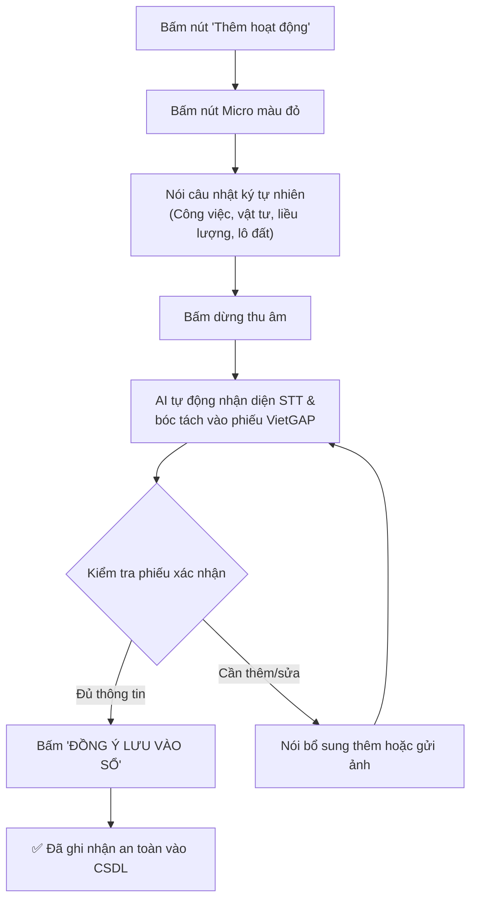

# 🌾 SỔ TAY HƯỚNG DẪN SỬ DỤNG ỨNG DỤNG NÔNG KÝ VIETGAP
> **Hệ thống ghi chép và số hoá nhật ký nông nghiệp rảnh tay bằng giọng nói & hình ảnh**  
> *Áp dụng cho Hợp tác xã, Tổ hợp tác và Nông hộ sản xuất cây ăn quả theo tiêu chuẩn VietGAP*

---

## 📑 MỤC LỤC
1. [Giới thiệu tổng quan & Lợi ích](#1-giới-thiệu-tổng-quan--lợi-ích)
2. [Cách truy cập & Đăng nhập ứng dụng](#2-cách-truy-cập--đăng-nhập-ứng-dụng)
3. [Tổng quan Giao diện Trang chủ](#3-tổng-quan-giao-diện-trang-chủ)
4. [Hướng dẫn Phân hệ 1: Ghi nhật ký canh tác (Giọng nói & Hình ảnh)](#4-hướng-dẫn-phân-hệ-1-ghi-nhật-ký-canh-tác-giọng-nói--hình-ảnh)
   - [4.1. Quy trình ghi nhật ký bằng giọng nói (3 bước đơn giản)](#41-quy-trình-ghi-nhật-ký-bằng-giọng-nói-3-bước-đơn-giản)
   - [4.2. Mẫu câu nói chuẩn cho từng công việc canh tác VietGAP](#42-mẫu-câu-nói-chuẩn-cho-từng-công-việc-canh-tác-vietgap)
   - [4.3. Ghi nhật ký bằng chụp ảnh bao bì, nhãn thuốc hoặc hóa đơn](#43-ghi-nhật-ký-bằng-chụp-ảnh-bao-bì-nhãn-thuốc-hoặc-hóa-đơn)
   - [4.4. Kiểm tra phiếu xác nhận và Lưu vào sổ](#44-kiểm-tra-phiếu-xác-nhận-và-lưu-vào-sổ)
5. [Hướng dẫn Phân hệ 2: Tra cứu & Quản lý Sổ nhật ký VietGAP](#5-hướng-dẫn-phân-hệ-2-tra-cứu--quản-lý-sổ-nhật-ký-vietgap)
   - [5.1. Dòng thời gian theo 5 giai đoạn sinh trưởng cây bưởi](#51-dòng-thời-gian-theo-5-giai-đoạn-sinh-trưởng-cây-bưởi)
   - [5.2. Lọc dữ liệu theo 5 biểu mẫu chuẩn VietGAP](#52-lọc-dữ-liệu-theo-5-biểu-mẫu-chuẩn-vietgap)
   - [5.3. Xem chi tiết, Chỉnh sửa và Xóa phiếu ghi chép](#53-xem-chi-tiết-chỉnh-sửa-và-xóa-phiếu-ghi-chép)
   - [5.4. Xuất báo cáo chứng nhận (Excel, Word, PDF)](#54-xuất-báo-cáo-chứng-nhận-excel-word-pdf)
6. [Hướng dẫn Phân hệ 3: Chẩn đoán Sâu bệnh & Tư vấn Kỹ thuật](#6-hướng-dẫn-phân-hệ-3-chẩn-đoán-sâu-bệnh--tư-vấn-kỹ-thuật)
   - [6.1. Chụp ảnh sâu bệnh thực địa](#61-chụp-ảnh-sâu-bệnh-thực-địa)
   - [6.2. Nhận kết quả chẩn đoán và phác đồ điều trị an toàn](#62-nhận-kết-quả-chẩn-đoán-và-phác-đồ-điều-trị-an-toàn)
7. [Mẹo sử dụng hiệu quả & Lưu ý khi thu âm](#7-mẹo-sử-dụng-hiệu-quả--lưu-ý-khi-thu-âm)
8. [Xử lý sự cố thường gặp (Hỏi - Đáp FAQ)](#8-xử-lý-sự-cố-thường-gặp-hỏi---đáp-faq)

---

## 1. GIỚI THIỆU TỔNG QUAN & LỢI ÍCH

**Nông Ký** là giải pháp phần mềm thông minh kết hợp Trí tuệ Nhân tạo (AI) giúp bà con nông dân và xã viên HTX không cần ghi chép sổ tay bằng giấy mực:

* 🎙️ **Nhập liệu rảnh tay 100% bằng giọng nói**: Vừa đi làm vườn về, tay dính bùn đất chỉ cần bấm nút và nói câu tiếng Việt tự nhiên là hệ thống tự điền vào sổ.
* 📷 **Chụp ảnh bao bì vật tư**: Chụp ảnh vỏ chai thuốc BVTV, bao bì phân bón hoặc hóa đơn bán lẻ, AI sẽ tự đọc tên, hoạt chất, số lượng và thời gian cách ly (PHI).
* 📋 **Tự động điền 5 biểu mẫu chuẩn VietGAP**:
  * **Bảng 1.5**: Sổ theo dõi mua và tiếp nhận vật tư nông nghiệp.
  * **Bảng 1.6**: Sổ theo dõi sử dụng phân bón, thuốc BVTV và chất kích thích.
  * **Bảng 1.7**: Sổ theo dõi thu gom và xử lý bao bì thuốc, rác thải nguy hại.
  * **Bảng 1.8**: Sổ theo dõi thu hoạch nông sản.
  * **Bảng 1.9**: Sổ theo dõi tiêu thụ, xuất bán sản phẩm.
* 📑 **Xuất báo cáo 1 chạm**: Xuất file Excel/Word/PDF chuẩn mẫu gửi đoàn kiểm tra VietGAP cấp giấy chứng nhận hoặc trình đối tác thu mua nông sản.
* 🛡️ **Tư vấn & Cảnh báo an toàn**: Kiểm tra chéo thời gian cách ly (PHI), phát hiện thuốc cấm, chẩn đoán sâu bệnh hại theo quy trình VietGAP.

---

## 2. CÁCH TRUY CẬP & ĐĂNG NHẬP ỨNG DỤNG

### 2.1. Thiết bị hỗ trợ
Ứng dụng hoạt động mượt mà trên mọi thiết bị:
- **Điện thoại thông minh**: iPhone, Samsung, Xiaomi, Oppo... (thông qua trình duyệt Safari, Google Chrome, Cốc Cốc).
- **Máy tính bảng / iPad**.
- **Máy vi tính để bàn / Laptop**.

### 2.2. Đường dẫn truy cập (URL)
Mở trình duyệt web và nhập địa chỉ hệ thống được Hợp tác xã cung cấp:
```text
https://<IP_MÁY_CHỦ>:5001
hoặc: https://192.168.40.5:5001
hoặc: https://localhost:5001
```

> [!NOTE] Xử lý cảnh báo chứng chỉ SSL tự ký lần đầu tiên
> Khi mở trang web qua giao thức bảo mật `https://`, nếu trình duyệt hiển thị thông báo **"Kết nối của bạn không phải là kết nối riêng tư"** (Your connection is not private):
> 1. Bấm vào chữ **Nâng cao** (Advanced).
> 2. Bấm vào dòng **Tiếp tục truy cập an toàn** (Proceed to ... unsafe).  
> *Thao tác này chỉ cần làm 1 lần duy nhất trên mỗi thiết bị.*

### 2.3. Đăng nhập tài khoản
Tại màn hình đăng nhập:
1. Nhập **Tài khoản nông dân** và **Mật khẩu**.
2. Nhấn nút **Đăng Nhập**.

> [!TIP] Tài khoản mẫu thử nghiệm
> Ngay phía dưới form đăng nhập có sẵn 2 nút tài khoản mẫu:
> * **Nông dân**: Tài khoản `nongdan1` / Mật khẩu `123456` *(Vũ Xuân Anh - HTX Đại Đồng)*.
> * **Quản trị**: Tài khoản `admin` / Mật khẩu `admin123`.  
> Bạn chỉ cần chạm vào nút để hệ thống tự điền thông tin.

---

## 3. TỔNG QUAN GIAO DIỆN TRANG CHỦ

Sau khi đăng nhập thành công, giao diện trang chủ hiển thị gồm 3 khu vực chính:

```
┌─────────────────────────────────────────────────────────────┐
│ 🌾 nông ký                                        [Thoát]  │
│ Nông hộ: Vũ Xuân Anh                                        │
├─────────────────────────────────────────────────────────────┤
│ ┌─────────────────────────────────────────────────────────┐ │
│ │ [HTX] HỢP TÁC XÃ ĐẠI ĐỒNG                              │ │
│ │ 📍 Xóm Đại Đồng - Xã Yên Trị - Tỉnh Phú Thọ              │ │
│ │ [P.U.C: VN-HBOR-0033]  [07 HA]  [Bưởi diễn]  [VietGAP]   │ │
│ │ ▼ Xem chi tiết Hợp tác xã & Vùng trồng                  │ │
│ └─────────────────────────────────────────────────────────┘ │
│                                                             │
│  [1. SỔ NHẬT KÝ CANH TÁC VIETGAP]                           │
│      Xem lịch sử công việc, biểu mẫu, xuất file báo cáo     │
│      👉 [Mở sổ nhật ký]                                     │
│                                                             │
│  [2. GHI NHẬT KÝ CANH TÁC]                                  │
│      Ghi nhanh bằng giọng nói hoặc chụp ảnh nhãn vật tư     │
│      👉 [Thêm hoạt động]                                    │
│                                                             │
│  [3. CHẨN ĐOÁN SÂU BỆNH & TƯ VẤN]                           │
│      Chụp ảnh lá/quả sâu bệnh, tra cứu thuốc & cách ly      │
│      👉 [Chẩn đoán sâu bệnh]                                │
└─────────────────────────────────────────────────────────────┘
```

1. **Thanh Header**: Logo nhận diện Nông Ký, tên Nông dân phụ trách và nút **Thoát (Đăng xuất)**.
2. **Thẻ Nông hộ & Vùng trồng (Farmer Card)**:
   - Hiển thị tên Hợp tác xã và địa chỉ canh tác.
   - Các thông số chuẩn hóa: **Mã số vùng trồng (P.U.C)**, **Quy mô diện tích (07 HA)**, **Giống cây trồng (Bưởi diễn)**, **Tiêu chuẩn (VietGAP Trồng trọt)**.
   - Bấm vào dòng *“Xem chi tiết Hợp tác xã & Vùng trồng”* để xem cụ thể danh sách các lô:
     * **Lô 1**: Vườn Bưởi diễn Trung tâm (`VN-HBOR-0033-L01`)
     * **Lô 2**: Vườn Bưởi diễn Bãi Sông Đà (`VN-HBOR-0033-L02`)
     * **Lô 3**: Vườn Bưởi diễn Đồi Cao (`VN-HBOR-0033-L03`)
3. **Ba lối vào chức năng chính**: Được thiết kế riêng biệt với nút bấm to rõ ràng, phù hợp cho bà con thao tác nhanh ngay tại vườn.

---

## 4. HƯỚNG DẪN PHÂN HỆ 1: GHI NHẬT KÝ CANH TÁC (GIỌNG NÓI & HÌNH ẢNH)

Đây là chức năng quan trọng nhất giúp bà con hoàn thành nghĩa vụ ghi chép sổ sách VietGAP chỉ trong 10 đến 20 giây.



### 4.1. Quy trình ghi nhật ký bằng giọng nói (3 bước đơn giản)

* **Bước 1: Bật Micro**: Nhấn vào nút Micro màu đỏ hình tròn ở góc dưới màn hình. *(Nếu là lần đầu tiên, hãy chọn "Cho phép" khi trình duyệt hỏi quyền sử dụng micro).*
* **Bước 2: Nói công việc của bạn**: Nói rõ ràng, tự nhiên theo giọng địa phương thông thường. Không cần dùng từ ngữ khuôn sáo hay chuẩn bị trước kịch bản.
* **Bước 3: Dừng và kiểm tra**: Nhấn nút dừng thu âm. Hệ thống AI trên máy sẽ chuyển giọng nói thành văn bản, phân loại biểu mẫu VietGAP và hiển thị một **Phiếu xác nhận**.

### 4.2. Mẫu câu nói chuẩn cho từng công việc canh tác VietGAP

Bà con có thể tham khảo các câu nói mẫu sau:

#### ① Phun thuốc bảo vệ thực vật (Điền vào Bảng 1.6)
> * **Mẫu 1**: *"Sáng nay tôi phun 2 bình 16 lít thuốc Radiant trừ sâu vẽ bùa ở lô 1, thời gian cách ly 7 ngày."*
> * **Mẫu 2**: *"Hôm nay phun thuốc Amistar Top trị nấm thán thư cho vườn bưởi lô 2, pha 20ml cho 1 bình."*
> * **Mẫu 3**: *"Phun thuốc trừ rầy Trebon ở lô 3, liều lượng một gói pha 1 bình 16 lít."*

#### ② Bón phân (Điền vào Bảng 1.6)
> * **Mẫu 1**: *"Chiều nay bón thúc 50 cân phân NPK Đầu Trâu cho vườn bưởi lô 1, bón xung quanh gốc cây."*
> * **Mẫu 2**: *"Hôm nay bón lót phân chuồng ủ hoai mục 3 tạ cho lô 2 phục hồi sau thu hoạch."*
> * **Mẫu 3**: *"Hòa 10 cân phân Kali tưới ẩm cho lô 3 giai đoạn nuôi quả non."*

#### ③ Mua vật tư nông nghiệp (Điền vào Bảng 1.5)
> * **Mẫu 1**: *"Sáng nay mua 5 bao phân lân nung chảy Lâm Thao tại đại lý Tuấn Mai, giá 250 nghìn một bao."*
> * **Mẫu 2**: *"Hôm qua mua 10 gói thuốc trừ sâu Radiant ở cửa hàng vật tư nông nghiệp huyện, hóa đơn số 124."*
> * **Mẫu 3**: *"Mua 2 chai thuốc trừ nấm Ridomil Gold đại lý Hùng Lan hết 360 nghìn."*

#### ④ Thu hoạch nông sản (Điền vào Bảng 1.8)
> * **Mẫu 1**: *"Hôm nay thu hoạch đợt 1 được 1 tấn bưởi Diễn tại lô 1, chuyển về nhà kho sơ chế dán tem."*
> * **Mẫu 2**: *"Hái 500 quả bưởi loại 1 ở lô 2, quả đều đẹp bảo đảm cách ly thuốc trên 20 ngày."*

#### ⑤ Xuất bán / Tiêu thụ sản phẩm (Điền vào Bảng 1.9)
> * **Mẫu 1**: *"Sáng nay bán 8 tạ bưởi Diễn cho Hợp tác xã Đại Đồng, giá 25 nghìn một cân."*
> * **Mẫu 2**: *"Xuất bán cho thương lái tại vườn 1200 quả bưởi lô 1, thu về 30 triệu đồng."*

#### ⑥ Xử lý vỏ bao bì, chai lọ thuốc (Điền vào Bảng 1.7)
> * **Mẫu 1**: *"Thu gom vỏ chai thuốc trừ sâu và vỏ bao phân bón đem bỏ vào bể chứa xi măng của lô 1."*
> * **Mẫu 2**: *"Sau khi phun thuốc xong, tráng sạch 3 lần vỏ chai rồi cho vào thùng rác chuyên dụng ngoài vườn."*

#### ⑦ Công việc canh tác khác (Làm cỏ, tỉa cành, tưới nước)
> * **Mẫu 1**: *"Sáng nay cắt tỉa cành tăm, cành sâu bệnh và quét vôi trắng gốc cây ở vườn lô 1."*
> * **Mẫu 2**: *"Hôm nay bật máy bơm tưới ẩm nhỏ giọt cho toàn bộ 7 héc ta vườn bưởi."*
> * **Mẫu 3**: *"Làm sạch cỏ dại xung quanh gốc bưởi và phủ rơm giữ ẩm lô 2."*

### 4.3. Ghi nhật ký bằng chụp ảnh bao bì, nhãn thuốc hoặc hóa đơn

Khi mua hoặc phun một loại thuốc BVTV có tên tiếng Anh khó đọc, bà con chỉ cần chụp ảnh:
1. Nhấn vào biểu tượng **Máy ảnh (Camera)** cạnh thanh nhập liệu (hoặc chọn gợi ý *"Chụp nhãn vật tư"*).
2. Chụp rõ ràng mặt trước chai thuốc, gói thuốc hoặc hóa đơn bán hàng.
3. Hệ thống sẽ tự động quét chữ (OCR), nhận dạng:
   - Tên thương mại và hoạt chất chính.
   - Công dụng phòng trừ đối tượng sâu bệnh nào.
   - Liều lượng pha khuyến cáo.
   - Thời gian cách ly (PHI) bắt buộc.
4. Tự động điền các thông tin này vào mẫu ghi nhật ký giúp bà con.

### 4.4. Kiểm tra phiếu xác nhận và Lưu vào sổ

Khi AI bóc tách xong, màn hình sẽ hiển thị **PHIẾU XÁC NHẬN**:
* Màu xanh lá đậm với tiêu đề hoạt động (Ví dụ: `PHIẾU XÁC NHẬN: Phun thuốc BVTV`).
* Liệt kê đầy đủ: Cây trồng, Tên thuốc/phân, Đối tượng trừ, Liều lượng, Thời gian cách ly, Lô thửa thực hiện.
* **Gợi ý bổ sung (nếu có)**: Nếu thiếu thông tin quan trọng (như chưa rõ liều lượng hay chưa có thời gian cách ly), hệ thống sẽ nhắc nhở bằng khung màu vàng 💡.
* **Thao tác chốt**:
  * Nhấn nút màu xanh lá **"ĐỒNG Ý LƯU VÀO SỔ"** $\rightarrow$ Dữ liệu được lưu ngay vào sổ nhật ký chính thức.
  * Nhấn nút đỏ **"HỦY"** nếu muốn bỏ lượt này để nói lại.

---

## 5. HƯỚNG DẪN PHÂN HỆ 2: TRA CỨU & QUẢN LÝ SỔ NHẬT KÝ VIETGAP

Để mở sổ nhật ký, tại trang chủ nhấn nút **"Mở sổ nhật ký"**.

### 5.1. Dòng thời gian theo 5 giai đoạn sinh trưởng cây bưởi
Sổ nhật ký được thiết kế thông minh, phân chia theo đúng chu kỳ phát triển của cây bưởi Diễn trong năm:
1. **Giai đoạn 1: Sau thu hoạch (Tháng 12 – 01)**: Tỉa cành, quét vôi, bón phân chuồng hoai & lân hồi rễ.
2. **Giai đoạn 2: Lộc xuân (Tháng 02)**: Tưới ẩm, bón thúc NPK đón lộc xuân, trừ sâu vẽ bùa & nhện đỏ.
3. **Giai đoạn 3: Ra hoa (Tháng 03 – 04)**: Phun Bo & vi lượng đậu quả, phòng bọ trĩ, nấm thán thư hại bông.
4. **Giai đoạn 4: Nuôi quả (Tháng 05 – 09)**: Tuyển quả, bao trái bưởi, phun Canxi-Bo, bón Kali ngọt quả.
5. **Giai đoạn 5: Thu hoạch (Tháng 10 – 11)**: Kiểm tra cách ly PHI, hái bưởi chín vàng và xuất bán.

> [!TIP]
> Bà con có thể bấm vào các thẻ giai đoạn ở đầu trang để xem nhanh trong giai đoạn đó mình đã làm những công việc gì.

### 5.2. Lọc dữ liệu theo 5 biểu mẫu chuẩn VietGAP
Bấm vào hộp chọn **"Bộ lọc hoạt động"** để xem riêng từng sổ theo dõi:
* **Tất cả hoạt động**: Xem toàn bộ lịch sử theo thứ tự thời gian từ mới nhất về cũ nhất.
* **Phun thuốc BVTV**: Lọc riêng các lần phun thuốc (Bảng 1.6).
* **Bón phân**: Lọc các lần bón phân, tưới phân (Bảng 1.6).
* **Mua vật tư**: Lọc sổ theo dõi mua phân bón, thuốc (Bảng 1.5).
* **Thu hoạch nông sản**: Lọc sản lượng thu hái từng đợt (Bảng 1.8).
* **Tiêu thụ nông sản**: Lọc lịch sử xuất bán cho HTX hoặc thương lái (Bảng 1.9).
* **Xử lý bao bì, rác thải**: Lọc sổ theo dõi thu gom rác nguy hại (Bảng 1.7).

### 5.3. Xem chi tiết, Chỉnh sửa và Xóa phiếu ghi chép
* **Xem chi tiết**: Bấm trực tiếp vào từng thẻ công việc trên dòng thời gian để xem toàn bộ thông tin chi tiết (người thực hiện, thời tiết, thiết bị phun, ngày giờ...).
* **Chỉnh sửa**: Nếu phát hiện ghi nhầm số lượng hoặc tên thuốc, bấm nút **Sửa** (hình cây bút) để cập nhật lại thông tin đúng.
* **Xóa bản ghi**: Bấm nút **Xóa** (hình thùng rác) nếu muốn hủy bỏ một bản ghi chép nhầm lẫn.

### 5.4. Xuất báo cáo chứng nhận (Excel, Word, PDF)
Ở góc trên cùng của Sổ nhật ký có các nút xuất báo cáo chính thức:
* **Xuất Excel (.xlsx)**: Tạo bảng tính đầy đủ 5 biểu mẫu VietGAP có kẻ khung, công thức tính tổng sản lượng và lượng vật tư tiêu thụ. Rất thích hợp để gửi email cho cơ quan cấp chứng nhận.
* **Xuất Word (.docx)**: Tạo văn bản sổ nhật ký có thể chỉnh sửa và in ấn đóng dấu HTX.
* **Xuất PDF (.pdf)**: Tạo file tài liệu cố định, tiện xem trên điện thoại hoặc in trực tiếp ra giấy để lưu tại văn phòng Hợp tác xã.

---

## 6. HƯỚNG DẪN PHÂN HỆ 3: CHẨN ĐOÁN SÂU BỆNH & TƯ VẤN KỸ THUẬT

Chức năng này đóng vai trò như một **Kỹ sư nông nghiệp 24/7** luôn đồng hành cùng bà con tại vườn.

### 6.1. Chụp ảnh sâu bệnh thực địa
1. Tại Trang chủ, bấm chọn **"Chẩn đoán sâu bệnh"**.
2. Nhấn nút **Máy ảnh (Camera)** và chụp cận cảnh vết bệnh:
   - Lá bị quăn, có đường ngoằn ngoèo màu bạc (Sâu vẽ bùa).
   - Lá có chấm nhỏ li ti màu vàng, mặt dưới có tơ (Nhện đỏ).
   - Quả có nốt mụn sần sùi màu nâu đen (Bệnh loét, ghẻ sẹo).
   - Cành cây chảy mủ, thối gốc (Nấm Phytophthora).
3. Hoặc nhấn nút **Micro** và mô tả triệu chứng bằng lời nói (Ví dụ: *"Cây bưởi nhà tôi lá non đang bị xoăn lại và có vệt trắng ngoằn ngoèo thì là bị làm sao?"*).

### 6.2. Nhận kết quả chẩn đoán và phác đồ điều trị an toàn
Hệ thống AI sẽ trả về kết quả gồm:
* **Tên sâu/bệnh hại**: Xác định chính xác tác nhân gây bệnh và mức độ nguy hại.
* **Biện pháp canh tác & Sinh học**: Các cách tỉa cành, dọn vệ sinh, bẫy bả không cần dùng hóa chất.
* **Thuốc đặc trị khuyến cáo**: Gợi ý các loại thuốc trong danh mục được phép dùng cho VietGAP (hoạt chất an toàn, hiệu lực cao).
* **Liều lượng pha & Cách phun**: Hướng dẫn tỷ lệ pha cho bình 16L hoặc phuy 200L.
* **Thời gian cách ly (PHI)**: Số ngày tối thiểu từ lúc phun đến lúc được phép hái quả.
* **Tra cứu kho HTX**: Kiểm tra ngay xem loại thuốc này đang có sẵn trong kho vật tư của trang trại hay không.

---

## 7. MẸO SỬ DỤNG HIỆU QUẢ & LƯU Ý KHI THU ÂM

| Yếu tố | Nên làm ✅ | Không nên làm ❌ |
| :--- | :--- | :--- |
| **Khoảng cách micro** | Giữ điện thoại cách miệng khoảng 15 – 25 cm | Không để quá xa (> 50cm) hoặc ghé quá sát môi |
| **Tốc độ nói** | Nói với tốc độ vừa phải, tự nhiên, ngắt nghỉ rõ ràng | Không nói quá vội vàng hoặc nói thì thầm |
| **Môi trường thu âm** | Tránh gió lùa trực tiếp vào lỗ micro của máy | Không bật quạt máy thổi thẳng vào điện thoại khi nói |
| **Nội dung thông tin** | Nêu đủ 3 yếu tố: **Việc gì + Vật tư/Số lượng + Lô nào** | Không nói cụt lủn (Ví dụ chỉ nói *"Đã phun thuốc"*) |
| **Chụp ảnh bao bì** | Đặt bao bì thẳng thớm, đủ ánh sáng, rõ tên chữ | Không chụp trong bóng tối, không chụp nhãn bị mờ rách |

---

## 8. XỬ LÝ SỰ CỐ THƯỜNG GẶP (HỎI - ĐÁP FAQ)

### ❓ Câu 1: Tại sao bấm nút Micro mà hệ thống không ghi âm được?
> **Nguyên nhân**: Trình duyệt trên điện thoại chưa được cấp quyền sử dụng Micro.  
> **Cách xử lý**:
> 1. Nhìn lên thanh địa chỉ của trình duyệt, bấm vào biểu tượng **ổ khóa** 🔒 hoặc biểu tượng **cài đặt trang web** cạnh chữ `https://`.
> 2. Chọn mục **Quyền (Permissions)** $\rightarrow$ Tìm mục **Microphone (Micrô)** và gạt sang trạng thái **Cho phép (Allow)**.
> 3. Tải lại trang web (F5) và thử lại.

### ❓ Câu 2: Tôi không nghe thấy trợ lý AI đọc tiếng trả lời?
> **Cách xử lý**:
> 1. Kiểm tra lại nút bật âm thanh (biểu tượng chiếc loa 🔊 ở góc trên giao diện trò chuyện).
> 2. Kiểm tra xem điện thoại có đang ở chế độ im lặng hoặc âm lượng đa phương tiện bị vặn về 0 hay không.

### ❓ Câu 3: Nếu tôi nói sai tên thuốc hoặc sai số lượng thì làm thế nào?
> **Cách xử lý**:
> 1. Khi màn hình hiện ra **Phiếu xác nhận**, nếu thấy sai bà con chỉ cần bấm nút **"HỦY"** màu đỏ và nói lại câu mới.
> 2. Nếu đã lỡ bấm lưu vào sổ, bà con mở phân hệ **Sổ nhật ký canh tác**, tìm đến phiếu đó và bấm biểu tượng cây bút để sửa lại các số liệu theo thực tế.

### ❓ Câu 4: Ứng dụng có dùng được khi mất mạng Internet không?
> **Trả lời**: **CÓ**. Hệ thống máy chủ đặt tại Hợp tác xã (sử dụng chip xử lý AI Rockchip RK3588) cho phép nhận diện giọng nói và bóc tách dữ liệu 100% Offline qua mạng Wi-Fi nội bộ của trang trại mà không phụ thuộc vào đường truyền Internet bên ngoài.

### ❓ Câu 5: Muốn in sổ nhật ký ra giấy nộp cho đoàn đánh giá VietGAP thì làm thế nào?
> **Cách xử lý**:
> 1. Vào mục **Sổ nhật ký canh tác**.
> 2. Chọn nút **"Xuất file Excel"** hoặc **"Xuất file PDF"**.
> 3. Tải file về máy tính và in ra giấy A4 chuẩn biểu mẫu VietGAP Trồng trọt.

---

> 📞 **Hỗ trợ Kỹ thuật & Quản trị Hợp tác xã**:  
> *Đơn vị vận hành*: Hợp tác xã Nông nghiệp Đại Đồng — Yên Trị, Phú Thọ  
> *Mã số vùng trồng (P.U.C)*: VN-HBOR-0033  
> *Hotline Kỹ thuật*: Liên hệ cán bộ quản trị HTX để được cấp lại mật khẩu hoặc hướng dẫn trực tiếp.
