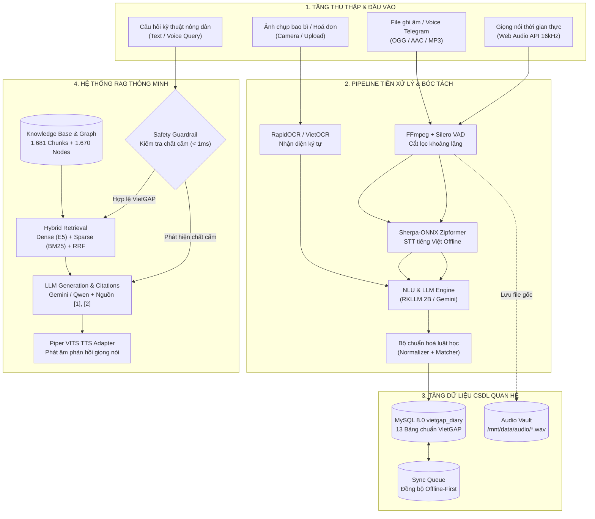
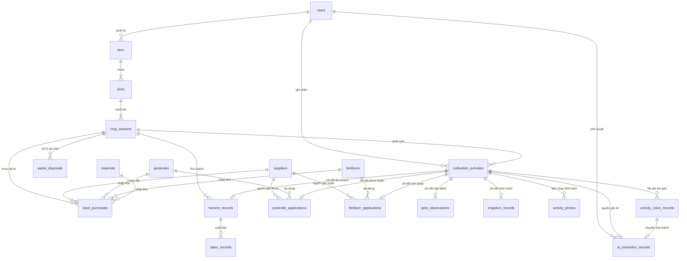
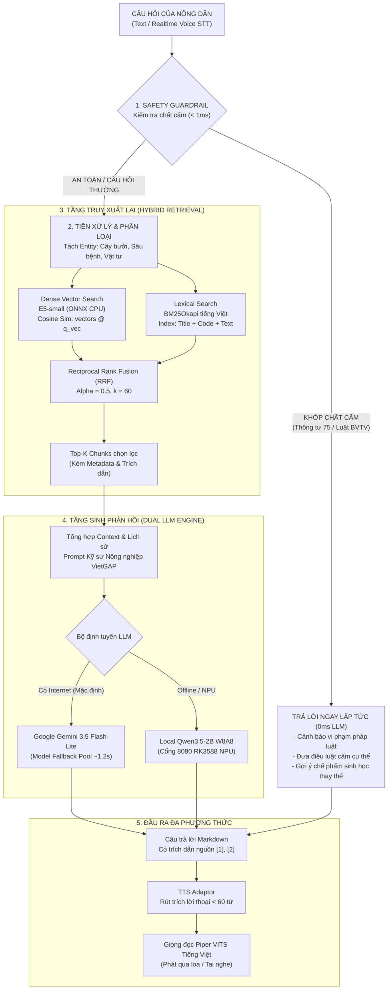

# KIẾN TRÚC DỮ LIỆU & KIẾN TRÚC RAG (RETRIEVAL-AUGMENTED GENERATION)
## HỆ THỐNG NÔNG KÝ AI - VOICE TO DATA VIETGAP

> **Phiên bản:** 2.0 - Production Architecture  
> **Nền tảng triển khai:** Edge AI (Rockchip RK3588 NPU Cores 0-2 / Odroid M2) & Hybrid Cloud (Google Gemini)  
> **Cơ sở dữ liệu:** MySQL 8.0 (`vietgap_diary`) & ONNX Vector Store (multilingual-e5-small)  

---

## 📑 MỤC LỤC
1. [Tổng quan Kiến trúc Hệ thống Toàn diện](#1-tổng-quan-kiến-trúc-hệ-thống-toàn-diện)
2. [Phần 1: Kiến trúc Dữ liệu Toàn diện (Data Architecture)](#phần-1-kiến-trúc-dữ-liệu-toàn-diện-data-architecture)
   - [1.1. Luồng chuyển dịch dữ liệu (Data Pipeline)](#11-luồng-chuyển-dịch-dữ-liệu-data-pipeline)
   - [1.2. Phân nhóm Mô hình Dữ liệu Quan hệ (13 Bảng MySQL)](#12-phân-nhóm-mô-hình-dữ-liệu-quan-hệ-13-bảng-mysql)
   - [1.3. Sơ đồ Thực thể Quan hệ (ERD Diagram)](#13-sơ-đồ-thực-thể-quan-hệ-erd-diagram)
   - [1.4. Ánh xạ trực tiếp 5 Biểu mẫu chuẩn VietGAP](#14-ánh-xạ-trực-tiếp-5-biểu-mẫu-chuẩn-vietgap)
   - [1.5. Cơ chế Kiểm toán, Toàn vẹn Dữ liệu & Offline-first Sync](#15-cơ-chế-kiểm-toán-toàn-vẹn-dữ-liệu--offline-first-sync)
3. [Phần 2: Kiến trúc Hệ thống RAG Nông Nghiệp Thông Minh (RAG Architecture)](#phần-2-kiến-trúc-hệ-thống-rag-nông-nghiệp-thông-minh-rag-architecture)
   - [2.1. Mục tiêu thiết kế & Thách thức đặc thù](#21-mục-tiêu-thiết-kế--thách-thức-đặc-thù)
   - [2.2. Sơ đồ Kiến trúc Pipeline RAG Đa tầng](#22-sơ-đồ-kiến-trúc-pipeline-rag-đa-tầng)
   - [2.3. Tầng 1: Chốt chặn an toàn hoá chất cấm (Safety Guardrail < 1ms)](#23-tầng-1-chốt-chặn-an-toàn-hoá-chất-cấm-safety-guardrail--1ms)
   - [2.4. Tầng 2: Dữ liệu Tri thức & Đồ thị Tri thức (Knowledge Base & Graph)](#24-tầng-2-dữ-liệu-tri-thức--đồ-thị-tri-thức-knowledge-base--graph)
   - [2.5. Tầng 3: Embedding Engine & Vector Store](#25-tầng-3-embedding-engine--vector-store)
   - [2.6. Tầng 4: Bộ máy Truy xuất Lai (Hybrid Retrieval with RRF)](#26-tầng-4-bộ-máy-truy-xuất-lai-hybrid-retrieval-with-rrf)
   - [2.7. Tầng 5: Sinh phản hồi Dual-Engine LLM & TTS Adapter](#27-tầng-5-sinh-phản-hồi-dual-engine-llm--tts-adapter)
   - [2.8. Giao tiếp Dịch vụ & Đánh giá Định lượng (RAG Evaluation)](#28-giao-tiếp-dịch-vụ--đánh-giá-định-lượng-rag-evaluation)
4. [Phần 3: Tổng hợp Ma trận Công nghệ & Tối ưu Biên](#phần-3-tổng-hợp-ma-trận-công-nghệ--tối-ưu-biên)

---

## 1. TỔNG QUAN KIẾN TRÚC HỆ THỐNG TOÀN DIỆN

Hệ thống **Nông Ký AI** được thiết kế theo mô hình **Edge-First Hybrid Architecture**:
- **Tại biên (On-Premises / Offline Farm)**: Thực thi nhận diện giọng nói (Sherpa-ONNX), xử lý âm thanh (Silero VAD), trích xuất LLM cục bộ (Qwen3.5-2B W8A8 trên 3 nhân NPU Rockchip RK3588), tìm kiếm vector ONNX CPU và lưu trữ CSDL MySQL độc lập.
- **Trên đám mây (Cloud Hybrid)**: Tự động chuyển đổi sang Google Gemini API (gemini-3.5-flash-lite) khi có kết nối Internet để tối ưu độ trễ xuống dưới ~1.5 giây.



---

## PHẦN 1: KIẾN TRÚC DỮ LIỆU TOÀN DIỆN (DATA ARCHITECTURE)

### 1.1. Luồng chuyển dịch dữ liệu (Data Pipeline)

Quá trình chuyển đổi từ **tín hiệu âm thanh phi cấu trúc** thành **bản ghi quan hệ chuẩn VietGAP** trải qua 5 bước nghiêm ngặt:

1. **Thu âm & Streaming nhị phân**:
   - Web Audio API thu âm trực tiếp từ trình duyệt, downsample tại client về `16,000 Hz, 16-bit PCM Mono`.
   - Client truyền từng chunk 250ms qua kênh WebSocket WSS (:8765) tới [realtime_stt.py](file:///root/voice_to_data/services/realtime_stt.py).
2. **Cắt đoạn VAD & Giải mã STT**:
   - Silero VAD phân tích biên độ giọng nói. Khi phát hiện khoảng lặng kéo dài quá `0.35s`, hệ thống chốt endpoint câu hoàn chỉnh.
   - Trình giải mã Sherpa-ONNX Zipformer chuyển đổi âm thanh thành chuỗi văn bản thô tiếng Việt (không dấu câu).
3. **Bóc tách cấu trúc bằng LLM (Structured Extraction)**:
   - Văn bản thô được đưa vào LLM với Schema JSON nghiêm ngặt, bóc tách các trường: loại hoạt động, ngày thực hiện, tên hoạt chất/phân bón, liều lượng, đơn vị, diện tích, đối tượng phòng trừ.
4. **Chuẩn hoá luật học & So khớp mờ (Normalizer & Material Matcher)**:
   - Module [normalizer](file:///root/voice_to_data/services/normalizer) quy đổi số chữ tiếng Việt ("hai chục ký" $\rightarrow$ 20, "năm mươi ngàn" $\rightarrow$ 50000).
   - Module [material_matcher.py](file:///root/voice_to_data/services/material_matcher.py) kết hợp LLM 0.6B và thuật toán `rapidfuzz` để so khớp tên nông dân phát âm ("an-vi", "an vin") với danh mục chuẩn trong CSDL ("Anvil 5SC").
5. **Ghi nhận & Kiểm toán (Persistence & Audit Trail)**:
   - Ghi bản ghi vào bảng gốc [cultivation_activities](file:///root/voice_to_data/data/schema.sql#L170-L199) và bảng con chi tiết tương ứng.
   - Đồng thời lưu trữ văn bản thô và toàn bộ JSON phản hồi vào bảng [ai_extraction_records](file:///root/voice_to_data/data/schema.sql#L408-L432) để phục vụ hậu kiểm.

---

### 1.2. Phân nhóm Mô hình Dữ liệu Quan hệ (13 Bảng MySQL)

Cơ sở dữ liệu `vietgap_diary` (định nghĩa tại [schema.sql](file:///root/voice_to_data/data/schema.sql)) được chuẩn hóa thành 5 phân hệ chức năng:

| Phân hệ | Danh sách bảng | Mục đích & Ý nghĩa trong quy trình VietGAP |
| :--- | :--- | :--- |
| **I. Quản trị & Vùng trồng** | `users`<br/>`farm`<br/>`plots`<br/>`crop_seasons` | Định danh nông hộ, mã vùng trồng phục vụ truy xuất nguồn gốc (`farm_code`), thông tin chứng nhận VietGAP, tọa độ GPS lô thửa, phân kỳ mùa vụ. |
| **II. Danh mục Vật tư (Catalog)** | `suppliers`<br/>`pesticides`<br/>`fertilizers`<br/>`materials` | Quản lý nhà cung ứng có pháp lý; danh mục thuốc BVTV kèm hoạt chất, số đăng ký, thời gian cách ly (PHI), cờ thuốc cấm (`is_banned`); danh mục phân bón kèm tỷ lệ NPK và tri thức kỹ thuật RAG dạng JSON. |
| **III. Nhật ký Canh tác (Core Operations)** | `cultivation_activities`<br/>`pesticide_applications`<br/>`fertilizer_applications`<br/>`pest_observations`<br/>`irrigation_records`<br/>`input_purchases`<br/>`harvest_records`<br/>`sales_records`<br/>`waste_disposals` | **Mô hình Bảng Cha - Bảng Con**: Bảng `cultivation_activities` chứa thuộc tính dùng chung (ngày, giờ, người làm, thời tiết, trạng thái xác nhận AI). Các bảng con kế thừa quan hệ 1-1 để lưu chi tiết nghiệp vụ tương ứng 5 biểu mẫu VietGAP. |
| **IV. Media & Bằng chứng Thực địa** | `activity_photos`<br/>`activity_voice_records` | Lưu vết đường dẫn ảnh hiện trường và file âm thanh gốc `.wav` tại `/mnt/data/audio/`, phục vụ chuyên gia đánh giá và thanh tra chứng nhận VietGAP. |
| **V. Hậu kiểm AI & Đồng bộ Ngoại tuyến** | `ai_extraction_records`<br/>`sync_queue` | **Lưu vết AI**: Raw transcript, JSON suy luận, độ trễ và người duyệt.<br/>**Offline-First**: Hàng đợi đồng bộ phân tán giữa thiết bị di động/biên và máy chủ trung tâm qua UUID. |

---

### 1.3. Sơ đồ Thực thể Quan hệ (ERD Diagram)



---

### 1.4. Ánh xạ trực tiếp 5 Biểu mẫu chuẩn VietGAP

Hệ thống tự động chuyển đổi dữ liệu quan hệ sang định dạng in ấn/báo cáo của 5 biểu mẫu bắt buộc theo tiêu chuẩn VietGAP Trồng trọt:

```
┌─────────────────────────────────────────────────────────────────────────────┐
│ 1. BẢNG 1.5: SỔ THEO DÕI MUA VẬT TƯ NÔNG NGHIỆP                             │
│   → Nguồn dữ liệu: input_purchases JOIN suppliers, pesticides, fertilizers  │
│   → Trường: Ngày mua, Tên vật tư, Nguồn cung, Số lượng, Hạn dùng, Số lô     │
├─────────────────────────────────────────────────────────────────────────────┤
│ 2. BẢNG 1.6: SỔ THEO DÕI SỬ DỤNG PHÂN BÓN, THUỐC BVTV & HOÁ CHẤT           │
│   → Nguồn dữ liệu: cultivation_activities JOIN pesticide_applications,      │
│                    fertilizer_applications, plots, pesticides               │
│   → Trường: Ngày phun/bón, Lô thửa, Tên thuốc/phân, Nồng độ, Liều lượng,    │
│             Đối tượng phòng trừ, Thời gian cách ly (PHI), Ngày thu hoạch an toàn│
├─────────────────────────────────────────────────────────────────────────────┤
│ 3. BẢNG 1.7: SỔ THEO DÕI XỬ LÝ BAO BÌ, THUỐC BVTV DƯ THỪA                  │
│   → Nguồn dữ liệu: waste_disposals JOIN crop_seasons                        │
│   → Trường: Ngày tiêu hủy/thu gom, Loại bao bì/chai lọ, Điểm thu gom, Xử lý │
├─────────────────────────────────────────────────────────────────────────────┤
│ 4. BẢNG 1.8: SỔ THEO DÕI THU HOẠCH NÔNG SẢN                                 │
│   → Nguồn dữ liệu: cultivation_activities JOIN harvest_records, plots      │
│   → Trường: Ngày thu hoạch, Lô thu hoạch, Khối lượng (kg), Địa điểm sơ chế  │
├─────────────────────────────────────────────────────────────────────────────┤
│ 5. BẢNG 1.9: SỔ THEO DÕI XUẤT BÁN SẢN PHẨM                                  │
│   → Nguồn dữ liệu: sales_records JOIN harvest_records                       │
│   → Trường: Ngày bán, Tên khách hàng/đơn vị thu mua, Khối lượng, Đơn giá    │
└─────────────────────────────────────────────────────────────────────────────┘
```

---

### 1.5. Cơ chế Kiểm toán, Toàn vẹn Dữ liệu & Offline-first Sync

1. **Khóa liên kết toàn vẹn & Phép tính an toàn**:
   - Trong bảng `pesticide_applications`, cột `safe_harvest_date` (ngày thu hoạch an toàn) được tính toán tự động bằng công thức:
     $$\text{safe\_harvest\_date} = \text{activity\_date} + \text{isolation\_days}$$
   - Nếu nông dân ghi nhận thu hoạch trước mốc `safe_harvest_date`, hệ thống kích hoạt cảnh báo vi phạm thời gian cách ly (PHI) ngay lập tức.
2. **Cơ chế Lưu vết AI (AI Audit Trail)**:
   - Không có bản ghi AI nào được ghi đè trực tiếp mà không có kiểm toán. Bảng `ai_extraction_records` lưu toàn văn chuỗi STT gốc, JSON suy luận, độ trễ và chuyển trạng thái từ `PENDING` $\rightarrow$ `APPLIED` khi nông dân hoặc kỹ thuật viên bấm xác nhận.
3. **Cơ chế Hàng đợi Đồng bộ Ngoại tuyến (Offline-First Sync Queue)**:
   - Bảng `sync_queue` sử dụng khoá duy nhất tổng hợp `(device_id, local_uuid)`.
   - Khi thiết bị tại hiện trường không có mạng, các thao tác `INSERT`, `UPDATE`, `DELETE` được gán UUID tại client và đẩy vào hàng đợi cục bộ.
   - Khi kết nối mạng phục hồi, tiến trình worker thực thi theo thứ tự thời gian (`FIFO`), cập nhật `record_id` thực từ server và đánh dấu `SYNCED`.

---

## PHẦN 2: KIẾN TRÚC HỆ THỐNG RAG NÔNG NGHIỆP THÔNG MINH (RAG ARCHITECTURE)

### 2.1. Mục tiêu thiết kế & Thách thức đặc thù

Hệ thống RAG cho nông nghiệp đòi hỏi các tiêu chuẩn đặc thù khắt khe:
1. **Tuyệt đối không ảo giác về chất cấm (Zero Hallucination)**: Nông dân hỏi về thuốc cấm (như Regent, Roundup, Wofatox) phải được ngăn chặn ngay lập tức, không để LLM tự do sinh lời khuyên sai trái dẫn đến vi phạm pháp luật và hủy chứng nhận VietGAP.
2. **Độ trễ thấp trên thiết bị biên**: Khả năng suy luận trên chip ARM RK3588 NPU hoặc máy tính nhúng, bộ nhớ RAM giới hạn.
3. **Thuật ngữ nông nghiệp địa phương phong phú**: Tên sâu bệnh, tên thương mại của thuốc ("bọ trĩ", "rầy chổng cánh", "loét cam sành", "rửa vườn").
4. **Trích dẫn nguồn minh bạch**: Phải chỉ rõ số hiệu tài liệu và đề mục kỹ thuật `[1]`, `[2]`.

---

### 2.2. Sơ đồ Kiến trúc Pipeline RAG Đa tầng



---

### 2.3. Tầng 1: Chốt chặn an toàn hoá chất cấm (Safety Guardrail < 1ms)

Được triển khai trong [services/safety_checker.py](file:///root/voice_to_data/services/safety_checker.py):
- **Căn cứ pháp lý**: Thông tư số 75/BNNMT của Bộ Nông nghiệp & Phát triển Nông thôn và Luật BVTV số 41/2013/QH13.
- **Cơ chế hoạt động**: Sử dụng bảng tra cứu bộ nhớ (`banned_pesticides.json`) kết hợp Regular Expression quét toàn bộ các biến thể tên hoạt chất (Fipronil, Glyphosate, Paraquat, Methyl Parathion, Carbofuran, Chlorpyrifos...) và tên biệt dược thương mại phổ biến (Regent, Roundup, Gramoxone, Wofatox, Furadan...).
- **Đặc tính kỹ thuật**:
  - Thời gian xử lý: **< 1.0 ms**.
  - Tỷ lệ ảo giác (Hallucination Rate): **0.0%**.
  - **Tự động đề xuất giải pháp thay thế VietGAP**: Nếu người nông dân hỏi *"Có nên dùng Regent trị bọ trĩ không?"*, hệ thống cảnh báo Regent chứa Fipronil đã bị cấm, đồng thời trả về ngay chế phẩm sinh học thay thế an toàn như: *Spinetoram (Radiant 60SC), Dầu khoáng nông nghiệp SK Enspray 99EC, hoặc vi sinh Bt*.

---

### 2.4. Tầng 2: Dữ liệu Tri thức & Đồ thị Tri thức (Knowledge Base & Graph)

Kho tri thức được đặt tại thư mục [knowledge/](file:///root/voice_to_data/knowledge/):
- **33 Tài liệu kỹ thuật nguồn**: Bao gồm quy chuẩn VietGAP, quy trình canh tác bưởi da xanh, bưởi Diễn, danh mục thuốc BVTV được phép sử dụng tại Việt Nam.
- **1.681 Chunks văn bản tối ưu**: Đã qua quy trình tiền xử lý loại bỏ toàn bộ trang bìa, mục lục, bảng chữ ký và văn bản hành chính rác.
  - Chiều dài chunk trung bình: **857.0 ký tự**.
  - Giới hạn độ dài: **100% chunks < 512 tokens** (đảm bảo không bao giờ bị cắt cụt/truncate khi embed).
- **Đồ thị tri thức (Knowledge Graph - `graph.json`)**:
  - Gồm **1.670 Nodes** và **2.355 Edges** kết nối ngữ nghĩa phân cấp giữa các thực thể:
    $$\text{Cây trồng (Bưởi)} \xrightarrow{\text{có sâu hại}} \text{Rầy chổng cánh} \xrightarrow{\text{gây bệnh}} \text{Vàng lá Greening} \xrightarrow{\text{biện pháp sinh học}} \text{Dầu khoáng SK 99EC}$$

---

### 2.5. Tầng 3: Embedding Engine & Vector Store

Được triển khai trong [services/embedding_engine.py](file:///root/voice_to_data/services/embedding_engine.py) và [services/rag_knowledge_base.py](file:///root/voice_to_data/services/rag_knowledge_base.py):
- **Mô hình Embedding**: `intfloat/multilingual-e5-small`.
- **Môi trường suy luận (Runtime)**: Chạy thuần CPU thông qua **ONNX Runtime (CPUExecutionProvider)** mà không phụ thuộc vào PyTorch hay GPU nặng nề, cực kỳ tương thích với kiến trúc ARM.
- **Không gian Vector**: 384 chiều, được chuẩn hoá $L_2$ (`normalize_embeddings=True`). Nhờ chuẩn hoá này, độ tương đồng Cosine giữa vector query $\vec{q}$ và vector tài liệu $\vec{d}$ chính bằng tích vô hướng (Dot Product):
  $$\text{CosineSimilarity}(\vec{q}, \vec{d}) = \vec{q} \cdot \vec{d}$$
- **Quy ước tiền tố E5 (Prefix Convention)**:
  - Tài liệu lưu trữ: Bắt buộc thêm tiền tố `"passage: "`.
  - Câu hỏi tìm kiếm: Bắt buộc thêm tiền tố `"query: "`.
- **Cơ chế Lưu đệm & Tự động Build lại (Index Caching)**:
  - Vector được lưu nhị phân tại `rag_index/vectors.npy` (kích thước ~2.5 MB).
  - Metadata tương ứng lưu tại `rag_index/metadata.json` (~15 MB).
  - Tự động so khớp MD5 Checksum qua `index_info.json`. Khi file tri thức gốc thay đổi, hệ thống tự động tái lập chỉ mục (Rebuild Index) ngầm.

---

### 2.6. Tầng 4: Bộ máy Truy xuất Lai (Hybrid Retrieval with RRF)

Để đạt độ chính xác tối đa, hệ thống kết hợp giữa **truy xuất ngữ nghĩa sâu (Dense)** và **truy xuất từ khóa chính xác (Sparse)**:

1. **Dense Retrieval (E5-small)**:
   - Nắm bắt ý định câu hỏi bằng ngôn ngữ tự nhiên dù người nông dân dùng từ đồng nghĩa hoặc diễn đạt mộc mạc.
2. **Sparse Retrieval (BM25Okapi)**:
   - Lập chỉ mục từ khóa tiếng Việt kết hợp tên mã thực thể (`section_title`, `section_code`, nội dung).
   - Bộ Tokenizer loại bỏ các hư từ không mang nghĩa (Stopwords) như: *và, của, cho, với, các, những, có, là, thì, để, như, thế nào, sao, gì...*
3. **Dung hợp thứ hạng RRF (Reciprocal Rank Fusion)**:
   - Kết hợp bảng xếp hạng của cả hai engine mà không bị ảnh hưởng bởi độ lệch thang đo điểm số:
   $$RRF(d) = \alpha \cdot \frac{1}{k + \text{rank}_{\text{dense}}(d)} + (1 - \alpha) \cdot \frac{1}{k + \text{rank}_{\text{bm25}}(d)}$$
   - Trong đó: Hệ số làm mịn $k = 60$, trọng số cân bằng $\alpha = 0.5$.
4. **Bộ lọc thực thể siêu dữ liệu (Metadata Pre-filtering)**:
   - Cho phép lọc trước theo phân cấp tri thức (`level_filter`: fact, chunk, guideline) và danh mục (`category_filter`).

---

### 2.7. Tầng 5: Sinh phản hồi Dual-Engine LLM & TTS Adapter

Được quản lý tập trung bởi [services/rag_engine.py](file:///root/voice_to_data/services/rag_engine.py):

#### 1. Cơ chế Chế độ Kép (Dual Engine Router)
- **Engine 1 - Cloud Google Gemini (Khuyên dùng khi có Internet)**:
  - Sử dụng bể dự phòng (Fallback Pool): `gemini-3.5-flash-lite` $\rightarrow$ `gemini-3.1-flash-lite` $\rightarrow$ `gemini-flash-latest` $\rightarrow$ `gemini-3.5-flash`.
  - Nếu một model bị giới hạn tốc độ (Rate Limit) hoặc quá tải, hệ thống tự động chuyển sang model tiếp theo trong mili-giây mà không làm gián đoạn người dùng.
- **Engine 2 - Local Qwen3.5-2B (Offline Edge)**:
  - Chạy mô hình lượng tử hoá `Qwen3.5-2B_RK3588_w8a8.rkllm` trực tiếp trên 3 nhân NPU Rockchip RK3588 (cổng 8080).
  - Tự chủ 100% ngoài vườn khi không có sóng di động hay Internet.

#### 2. Kỹ thuật Prompt Kỹ sư Nông nghiệp VietGAP
- **Nguyên tắc "4 đúng"**: Đúng thuốc, đúng nồng độ/liều lượng, đúng lúc, đúng cách.
- **Thứ tự ưu tiên**: Luôn hướng dẫn biện pháp canh tác (cắt tỉa cành, thoát nước) và biện pháp sinh học (nấm đối kháng Trichoderma, dầu khoáng, bao trái) trước khi can thiệp hoá chất.
- **Trích dẫn nguồn bắt buộc**: Cuối mỗi luận điểm chuyên môn, LLM phải gán số hiệu `[1]`, `[2]` trỏ về tài liệu nguồn.

#### 3. Bộ chuyển đổi Giọng đọc (TTS Spoken Text Adaptor)
- Sau khi có câu trả lời đầy đủ, engine thực hiện bước tóm tắt đặc thù:
  - Rút ngắn xuống dưới **60 từ**.
  - Loại bỏ hoàn toàn ký tự Markdown (`*`, `#`, `-`), số thứ tự và bảng biểu.
  - Xưng hô lễ phép, thân mật (*"Em xin hướng dẫn bác...", "Bác nhớ chú ý..."*).
  - Cung cấp văn bản sạch cho bộ tổng hợp giọng nói tiếng Việt **Piper VITS**, đọc trực tiếp ra loa cho nông dân nghe ngay ngoài hiện trường.

---

### 2.8. Giao tiếp Dịch vụ & Đánh giá Định lượng (RAG Evaluation)

#### 1. REST API Blueprint ([services/rag_service.py](file:///root/voice_to_data/services/rag_service.py))
- `GET  /rag/health`: Kiểm tra trạng thái service, kích thước index và phiên bản model.
- `POST /rag/search`: Tìm kiếm vector similarity và hybrid scoring.
- `POST /rag/search/context`: Tìm kiếm và tự động tổng hợp khối context sẵn sàng nạp cho LLM.
- `POST /rag/eval`: Chạy đánh giá tự động trên tập dữ liệu benchmark.
- `POST /rag/index/rebuild`: Kích hoạt tiến trình xây dựng lại chỉ mục từ dữ liệu nguồn.

#### 2. Công cụ Dòng lệnh Tương tác ([cli/rag_chat.py](file:///root/voice_to_data/cli/rag_chat.py))
- Giao diện console trực quan hỗ trợ các lệnh: `/gemini` (chuyển cloud), `/local` (chuyển offline NPU), `/top <N>`, `/temp <T>`, `/sources` (bật/tắt hiển thị tài liệu nguồn).

#### 3. Bộ đánh giá Benchmark Định lượng ([cli/rag_eval.py](file:///root/voice_to_data/cli/rag_eval.py))
- Được kiểm thử định kỳ trên tập dữ liệu chuẩn **114 câu hỏi kỹ thuật VietGAP** ([data/rag/rag_eval.jsonl](file:///root/voice_to_data/data/rag/rag_eval.jsonl)):
  - **Recall@1, Recall@3, Recall@5**: Tỷ lệ tìm thấy tài liệu chứa đáp án trong top kết quả.
  - **Mean Reciprocal Rank (MRR)**: Đo lường vị trí xuất hiện trung bình của tài liệu chính xác nhất.

---

## PHẦN 3: TỔNG HỢP MA TRẬN CÔNG NGHỆ & TỐI ƯU BIÊN

| Hạng mục thành phần | Công nghệ / Thuật toán sử dụng | Thời gian xử lý (Latency) | Vị trí thực thi |
| :--- | :--- | :--- | :--- |
| **VAD (Voice Activity Detection)** | Silero VAD (ONNX) | ~15 - 20 ms / frame | Edge (CPU ARM) |
| **Speech-to-Text (STT)** | Sherpa-ONNX Zipformer Tiếng Việt | Thời gian thực (RTF ~ 0.25) | Edge (CPU ARM) |
| **Safety Guardrail (Chất cấm)** | Regex & Hashmap Lookups (TT 75/BNNMT) | **< 1.0 ms** | Edge (Bộ nhớ RAM) |
| **Vector Embedding** | `multilingual-e5-small` (ONNX Runtime) | ~35 - 50 ms / câu hỏi | Edge (CPU ARM) |
| **Lexical Search** | BM25Okapi với Custom Vietnamese Tokenizer | ~5 - 10 ms | Edge (RAM Cache) |
| **Xếp hạng & Hợp nhất** | Reciprocal Rank Fusion (RRF, k=60) | ~2 - 3 ms | Edge (CPU ARM) |
| **LLM Cloud Generation** | Google Gemini 3.5 Flash-Lite API | ~800 - 1.200 ms | Cloud Google |
| **LLM Edge Generation** | Qwen3.5-2B W8A8 (RKLLM Runtime) | ~1.500 - 2.800 ms | Edge (3 nhân NPU RK3588) |
| **Text-to-Speech (TTS)** | Piper VITS Tiếng Việt | ~200 - 350 ms | Edge (CPU ARM) |
| **Cơ sở dữ liệu Quan hệ** | MySQL 8.0 (`vietgap_diary`) | ~5 - 15 ms / query | Edge (MySQL Service) |

---

> [!NOTE]
> **Khả năng mở rộng trong tương lai**:
> - Hệ thống sẵn sàng kết nối mô hình thị giác **VLM (Qwen2-VL / Gemini Vision)** để chẩn đoán trực tiếp bệnh hại trên lá và quả bưởi thông qua ảnh chụp camera thực địa.
> - Hỗ trợ mở rộng danh mục cây trồng sang Sầu riêng, Cam sành, Xoài cát theo các quy trình VietGAP tương ứng chỉ bằng cách nạp thêm file tài liệu vào thư mục `knowledge/` và kích hoạt `/rag/index/rebuild`.
